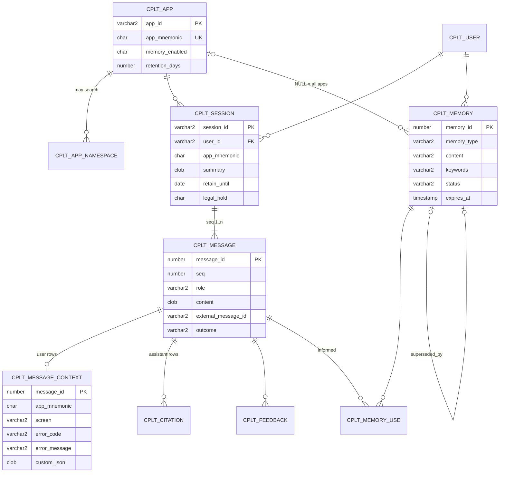

# Oracle data model: chat sessions and long-term memory

Stores every copilot conversation with the context it was asked in, and keeps a small set of durable
**memories** per user that are recalled into later conversations.

| Script | Oracle | What it does |
| --- | --- | --- |
| `01_schema.sql` | 19c+ | Tables, indexes, reporting views |
| `02_chat_api.sql` | 19c+ | `cplt_chat_api` package: the only thing the gateway calls |
| `03_vector_23ai.sql` | 23ai only, optional | Vector columns and indexes, `cplt_vector_api` for semantic recall |
| `04_seed.sql` | any | App registry rows matching `config/apps.example.json` |
| `test/test_chat_api.sql` | 19c+ | Assertion-based smoke test of the whole API (rolls back) |
| `99_drop.sql` | any | Drops everything (dev only) |

## Model



How it maps to the widget/gateway protocol:

| Protocol | Column |
| --- | --- |
| `conversationId` | `cplt_session.session_id` |
| user identity from `auth.js` | `cplt_user.user_id` |
| `appId`, `appMnemonic` | `cplt_session.app_id`, `app_mnemonic` (checked against `cplt_app`, like the gateway does) |
| `context.screen`, `route`, `url`, `error.*` | `cplt_message_context` columns |
| `context.custom` | `cplt_message_context.custom_json` |
| `citation` events | `cplt_citation` |
| `done.messageId` | `cplt_message.external_message_id`, used by `/v1/feedback` |

### Two kinds of memory

- **Session summary** (`cplt_session.summary`): a few lines describing a whole conversation, rewritten as it
  goes. Recalled with `recent_summaries` (latest N) or, on 23ai, `similar_sessions` (by meaning).
- **Memories** (`cplt_memory`): single statements worth keeping beyond the session, typed as
  `PREFERENCE`, `ENVIRONMENT`, `FACT`, `RESOLUTION` or `OPEN_ISSUE`, per user, per app or across apps.
  Corrections insert a new row and mark the old one `SUPERSEDED`, so answers that used the old one stay
  explainable. `cplt_memory_use` records which memories went into which answer.

Recall without vectors (`recall_memories`) scores keyword hits on error codes, job names and JIRA keys,
always includes preferences and environment, and is scoped to the current app plus cross-app memories.
On 23ai, `cplt_vector_api.recall_semantic` does the same by embedding distance.

## How the gateway uses it

Per question, around the existing `handleChat`:

1. **Before** calling Eliza: `recall_memories(user, app, terms)` with terms from the question and
   `context.error.code` / `jobName`, plus `recent_summaries`. Pass them to Eliza as a memory block in
   the request (and keep their ids).
2. **After** the `done` event: one call to `record_turn(...)` with question, answer, normalised context
   JSON, citations JSON, the recalled memory ids, model, token counts and latency.
3. **Async, not on the request path**: every few turns, ask the model for an updated session summary and
   for new memories ("what from this conversation is worth remembering for next time?"), then
   `save_session_summary` and `add_memory`.
4. `/v1/feedback` → `record_feedback(messageId, user, rating)`.

The gateway needs `EXECUTE` on `cplt_chat_api` only. Not wired into the gateway code yet: that needs
the `oracledb` Node driver and a decision on where the summarise/extract step runs (gateway or Eliza).

## Retention and privacy

- `cplt_app.retention_days` (default 400) sets `retain_until` when a session starts. `purge_expired`
  deletes expired sessions and everything under them, except sessions on `legal_hold`; schedule it
  nightly (job definition at the end of `02_chat_api.sql`). Memories outlive their source session
  (source columns go NULL) until `expires_at`, rejection, or `forget_user`.
- `forget_user` removes a user's memories, feedback and non-held sessions and opts them out of memory.
- `cplt_user.memory_opt_out` and `cplt_app.memory_enabled` stop new memories.
- Questions, answers and error messages may contain client data: use a TDE-encrypted tablespace, and
  consider VPD or Data Redaction on `cplt_message.content` and `cplt_message_context.error_message` for
  support/reporting users. The gateway already avoids logging these; the database is now where they live.
- High volume on Enterprise Edition with Partitioning: interval-partition `cplt_message` by month (the
  clause is in a comment above the table) so purges can drop partitions.

## Run locally

```bash
docker run -d --name cplt-oracle -p 1521:1521 -e ORACLE_PASSWORD=<sys-password> \
  -e APP_USER=copilot -e APP_USER_PASSWORD=<app-password> gvenzl/oracle-free:23-slim
# when the log says DATABASE IS READY TO USE:
for f in 01_schema.sql 02_chat_api.sql 03_vector_23ai.sql 04_seed.sql test/test_chat_api.sql; do
  docker exec -i cplt-oracle sqlplus -s copilot/<app-password>@FREEPDB1 < db/oracle/$f
done
```
